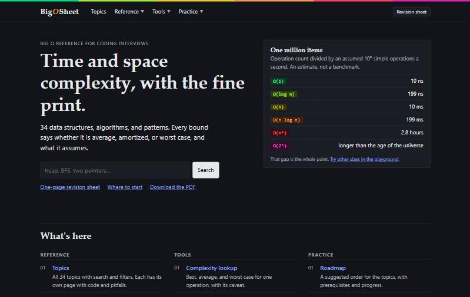

# BigOSheet: a Big O cheat sheet

A compact, browser-friendly reference for comparing the time and space complexities of common data structures, sorting algorithms, and the graph and tree algorithms that come up in DSA interviews. Every bound says whether it is average, amortized, or worst case, and what it assumes.

**Live site:** [aryanjsx.github.io/BigOSheet](https://bigosheet.aryankr.in)

Created and maintained by [Aryan Kumar](https://github.com/aryanjsx).



Built with [Next.js](https://nextjs.org) (App Router), React, and TypeScript, and exported as a fully static site. It needs no server, database, or account, and can be hosted on GitHub Pages or any static host.

## Pages

| Page | Path | What it covers |
| --- | --- | --- |
| Home | `/` | Search, where to start, and the costs asked about most |
| Topics | `/topics/` | All 34 topics with search and filters |
| Topic | `/topics/<id>/` | One page per topic: why it costs that, code, pitfalls, prerequisites |
| Big O basics | `/basics/` | Notation, the growth playground, and the color key |
| Data structures | `/data-structures/` | Common operations, more structures, priority queues, graph representations |
| Sorting | `/sorting/` | Best, average, and worst case for array sorts |
| Search and graphs | `/algorithms/` | Search, traversal, heaps, shortest paths, spanning trees |
| Coding patterns | `/patterns/` | Typical costs of common interview patterns |
| Lookup, Compare, Visualizer, Export | `/lookup/`, `/compare/`, `/visualizer/`, `/export/` | Tools |
| Roadmap, Quiz, Challenges, Revision sheet | `/roadmap/`, `/quiz/`, `/challenges/`, `/revision/` | Practice |

Links from the old single-page site (`#algo=bfs`, `#compare=a,b`, `#revision`) redirect to the matching page.

## What's included

- **Search and filters:** search by name or keyword, then filter by topic, complexity class, interview relevance, or your own progress.
- **Explanation cards:** 34 topics, each with when to use it, why it costs what it does, a Python example (plus Java, C++, and JavaScript on seven cards), common pitfalls, and a reference link.
- **Complexity lookup:** best, average, and worst case for an operation, with the assumption and caveat behind each.
- **DSA interview roadmap:** all 34 topics in a suggested order with prerequisites and progress tracking.
- **Big O playground:** an interactive growth chart with operation counts and illustrative time estimates (operation counts divided by an assumed 10⁸ operations per second, not benchmarks).
- **Reference tables:** data structure operations, more data structures, priority queues, graph representations, sorting, algorithm complexity, graph and tree algorithms, and coding patterns.
- **Algorithm visualizer:** step through linear search, binary search, bubble sort, insertion sort, merge sort, quicksort, BFS, and DFS. Sorts can start from random, sorted, or reversed input to show best and worst cases.
- **Big O quiz and code challenges:** practice with explanations after every answer.
- **Compare two algorithms:** side-by-side table, copyable as Markdown, shareable by link.
- **Export and share:** Markdown, CSV, printable topic cards, and links to any topic (`/topics/bfs/`) or comparison (`/compare/#mergesort,quicksort`).
- **One-page revision sheet, print stylesheet, and PDFs.**
- **Accessibility:** keyboard shortcuts (press `?`), visible focus states, a skip link, screen reader announcements, and support for the reduced-motion setting.

Progress (saved topics, learned topics, and quiz scores) is stored in your browser's local storage on this device only. No account or backend is involved, and nothing syncs between devices. If the browser blocks storage, the site says so and progress lasts only until the page is closed. You can clear progress from the roadmap page.

## Get started

You need Node.js 22.12 or later.

```bash
npm ci
```

```bash
npm run dev
```

Then open http://localhost:3000.

| Command | What it does |
| --- | --- |
| `npm run dev` | Starts the development server with hot reload |
| `npm run build` | Builds the static site into `out/` |
| `npm start` | Serves `out/` locally to check the production build |
| `npm run lint` | Runs ESLint |
| `npm run typecheck` | Runs the TypeScript compiler without emitting files |
| `npm test` | Runs the unit tests and the content validation |
| `npm run validate` | Runs only the content validation (ids, links, quiz answers, roadmap order) |
| `npm run check-links` | After a build, checks every link, asset, anchor, canonical URL, and heading level in `out/` |
| `npm run check` | Runs all of the above in order, the same as CI |

## Accuracy first

The point of this site is to be right. Every complexity claim names its case (best, average, amortized, or worst) and its assumptions, uses Θ only where a bound is tight, and links a source where the claim is not obvious. The latest review of every claim, with sources, is in [docs/complexity-audit.md](docs/complexity-audit.md). If you spot a wrong bound, [open an issue](https://github.com/aryanjsx/BigOSheet/issues/new/choose) with a source.

`npm test` also checks the data itself: every topic id that another file refers to exists, quiz answers point at a real option, challenge answers are among their options, roadmap prerequisites come earlier in the order, and every route in the navbar has a page.

## Deploy

`.github/workflows/deploy.yml` runs on every pull request and every push to `main`. It installs from the lockfile, then runs lint, the type check, the tests, the build, and the link check. Only a push to `main` that passes every step is deployed to GitHub Pages.

One-time setup: in the repository settings, under **Pages**, set **Source** to **GitHub Actions**.

To build for a subpath yourself, set `NEXT_PUBLIC_BASE_PATH` and `NEXT_PUBLIC_SITE_URL` before building:

```bash
NEXT_PUBLIC_BASE_PATH=/BigOSheet NEXT_PUBLIC_SITE_URL=https://bigosheet.aryankr.in npm run build
```

## Troubleshooting

| Problem | Fix |
| --- | --- |
| The live site shows the README instead of the app, and every other page is a 404 | Pages is still set to deploy from a branch. Set **Settings → Pages → Source** to **GitHub Actions**, then rerun the workflow. |
| Pages load without styles, or links go to the wrong place, on GitHub Pages | The build ran without `NEXT_PUBLIC_BASE_PATH`. CI sets it to `/<repo-name>`; set it yourself for local subpath builds. `npm run check-links` catches this. |
| `npm test` fails with an engine or syntax error | Use Node.js 22.12 or later. |
| On Windows Git Bash, the build fails with "basePath has to start with a /" | Git Bash rewrites paths in environment variables. Prefix the command with `MSYS_NO_PATHCONV=1`. |
| A hydration warning appears in the browser console | Something random or browser-only is changing the first render. See "Adding a page or feature" in [CONTRIBUTING.md](CONTRIBUTING.md). |
| `npm run check-links` says there is no `out/` folder | Run `npm run build` first. |

## Project layout

```
public/                         PDFs and other static files
docs/                           The complexity audit and the README screenshot
scripts/
  check-links.mjs               Checks the built site in out/
  flatten-prefetch.mjs          Post-build fix for Next.js prefetch file names in static export
tests/                          Unit tests and content validation (Vitest)
src/
  app/
    layout.tsx                  Header, footer, metadata, JSON-LD, and providers
    page.tsx                    Home page
    <route>/page.tsx            One folder per page; topics/[id] builds a page per topic
    globals.css                 Design tokens, tables, features, and print rules
    site.css                    Header, navigation, footer, page headers, and home
    sitemap.ts                  Generates sitemap.xml from every route
    og.png/route.tsx            Builds the social preview image
  data/                         All content, typed (see types.ts)
    entries.ts                  Search cards; also feed the revision sheet, roadmap, and exports
    lookup.ts                   Complexity lookup rows
    roadmap.ts                  Roadmap levels and prerequisites
    quiz.ts                     Quiz questions
    challenges.ts               Code complexity challenges
    compare.ts                  Comparison data
    multilang.ts                Java, C++, and JavaScript card snippets
  context/
    ProgressContext.tsx         React access to saved progress
    SheetContext.tsx            Shared UI state: search filters, dialogs, announcements
  lib/
    routes.ts                   Every page and nav group; used by the navbar, footer, home, and sitemap
    progressStore.ts            Saved progress in localStorage under the bigo:v1 key
    visualizer.ts               Frame builders for each visualized algorithm
    growth.ts                   Growth curves and number formatting for the playground
    ...                         Search, metadata, and small helpers
  components/
    sections/                   Static reference tables, one file per section
    interactive/                Search, topic actions, lookup, roadmap, playground, visualizer, quiz, and more
    home/                       Pieces used only on the home page
    layout/                     Site header and footer, page header, on-this-page links, shortcuts, print cards
    ui/                         Small shared pieces: CopyButton, LangTabs, Field
```

## Contributing

See [CONTRIBUTING.md](CONTRIBUTING.md) for the accuracy rules and how to add content or features.

## License

[MIT](LICENSE) © Aryan Kumar
